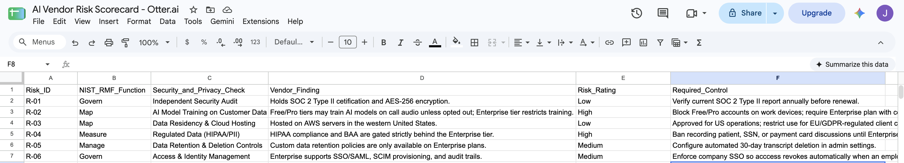

# enterprise-ai-grc-framework
# Enterprise AI Vendor Risk Assessment & Acceptable Use Policy

A governance, risk, and compliance (GRC) evaluation pack assessing third-party AI meeting assistants (Otter.ai) against the **NIST AI Risk Management Framework (AI RMF 1.0)** and establishing an internal enterprise Acceptable Use Policy.

## Business Problem
Employees frequently adopt free or unvetted AI transcription tools without IT approval, exposing organizations to silent model-training opt-ins, unencrypted storage, and HIPAA/PII compliance violations. This project translates security and privacy documentation into actionable procurement controls and employee guardrails.

## Deliverables Included
* **`vendor_risk_scorecard.csv`** — 6-point third-party risk register mapped to NIST AI RMF functions (`Govern`, `Map`, `Measure`, `Manage`) with severity ratings and required technical controls.
* **`AI_Acceptable_Use_Policy.pdf`** — 1-page corporate governance policy defining approved tool tiers, a 3-tier Traffic-Light data classification system (Green/Yellow/Red), human-in-the-loop review rules, and 24-hour incident reporting.

## Risk Scorecard Preview

## Key Risk Findings & Controls
* **AI Model Training (High Risk):** Free/Pro tiers permit model training on customer audio by default; mitigated by mandating Enterprise-tier contracts with zero-data-retention opt-outs.
* **Regulated Data Exposure (High Risk):** HIPAA Business Associate Agreements (BAAs) are restricted to Enterprise plans; mitigated by prohibiting PII/PHI recording prior to BAA execution and enforcing Red-tier classification bans.
* **Identity & Lifecycle Governance (Medium Risk):** Mitigated by requiring SSO/SAML authentication, SCIM automated offboarding, and 30-day transcript retention limits.
